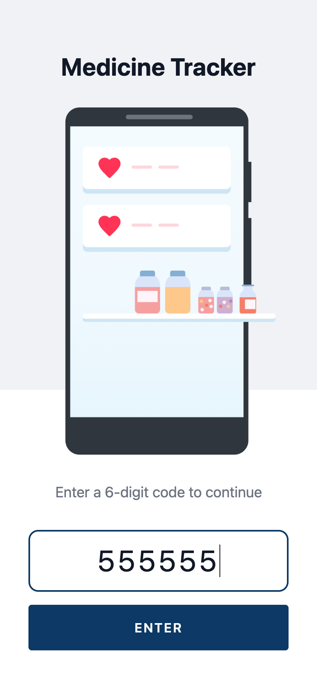
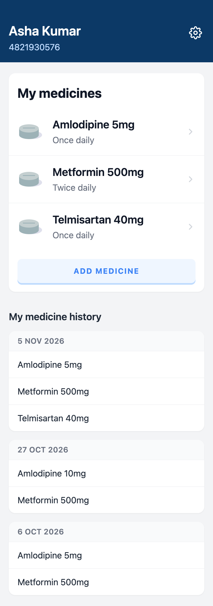
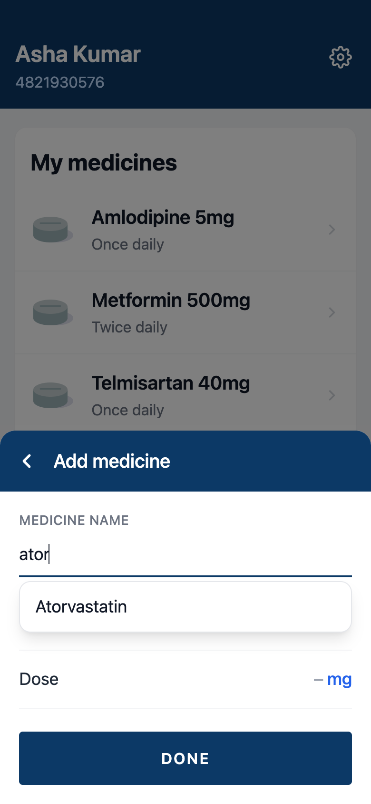
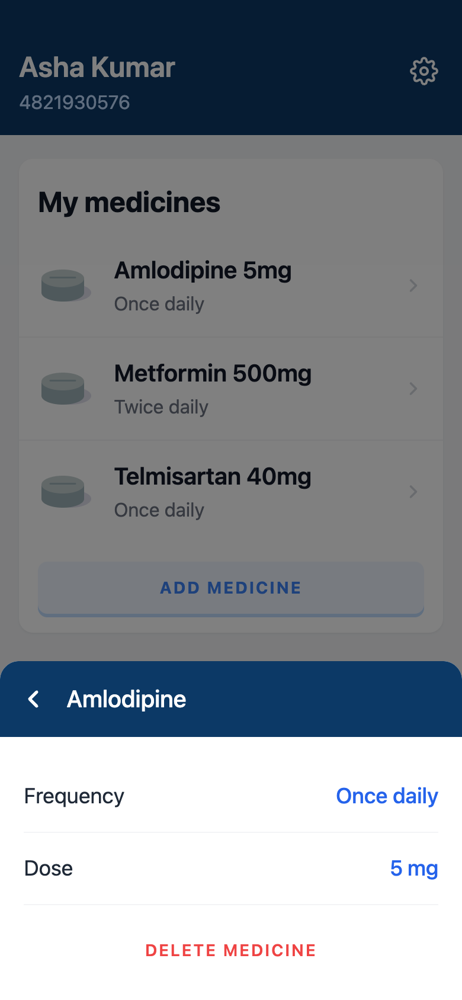
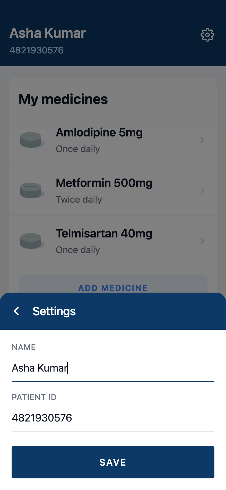

# Medicine Tracker

A simple phone app for keeping an up-to-date list of the medicines you take, with a dated record of every change.

**Live app:** https://medicine-tracker-lyart.vercel.app/

## The problem

People living with long-term conditions such as high blood pressure or diabetes often take several medicines at once. Doctors change doses, add medicines and stop others at each visit. Over months, it gets hard to remember exactly what you take today, and harder to remember what you took before.

That matters at the clinic. A doctor needs the current list and its recent changes to make safe decisions. Most people bring a worn paper slip, a bag of pill strips or their memory.

## Who it's for

- **People taking medicines every day**, especially for long-term conditions.
- **Family members and caregivers** who manage medicines for someone else.

The screens use large text and few buttons, so people who aren't comfortable with phones can still use the app.

## What it does

Medicine Tracker keeps one clear list of your current medicines on your phone. Each day the list changes, the app saves a dated copy. At a clinic visit, you can show the doctor your current list and how it has changed.

### Main features

- **Log in with a 6-digit code.** No email or password needed. A new code creates a new account.
- **Add a medicine** with its name, dose in mg and how often you take it. Names of common medicines appear as suggestions while you type.
- **Change a dose or frequency.** Tap the medicine and pick the new value. It saves on its own.
- **Delete a medicine** you no longer take.
- **See your history.** The app keeps one dated record for each day the list changes, so you can see what you took on past dates.
- **Add your name and Patient ID** to the top of the screen, so a clinic can match the list to your records.
- **Use it on any device.** Your data is stored online, so it's there when you log in from another phone or browser.
- **Install it on your phone** from the browser, like a regular app.

> **Note:** the 6-digit code is the only login. Anyone who knows or guesses a code can see that account's medicines. Don't store sensitive records in the app until it has a stronger login.

## Screenshots

The screenshots use made-up sample data.

| Log in | Your medicines and history | Add a medicine |
|---|---|---|
|  |  |  |

| Change or delete a medicine | Name and Patient ID |
|---|---|
|  |  |

### The main flow

1. **Log in** with your 6-digit code.
2. **See your medicines.** The home screen shows your current list, with your history below it.
3. **Add a medicine.** Tap **Add medicine**, type the name, set the dose and frequency, then tap **Done**.
4. **Make a change.** Tap a medicine to change its dose or frequency, or to delete it.
5. **Check your history.** Each date shows the full list for that day. In the sample, the Amlodipine dose went from 5 mg to 10 mg and back.

## How it's built

### Tech stack

| Part | Tool | What it does |
|---|---|---|
| Screens | [React](https://react.dev) 18 | Builds the user interface |
| Build tool | [Vite](https://vitejs.dev) 5 | Runs the app locally and bundles it for release |
| Styling | [Tailwind CSS](https://tailwindcss.com) 3 | Styles the screens |
| Installable app | [vite-plugin-pwa](https://vite-pwa-org.netlify.app) | Lets people add the app to their home screen |
| Server | [Vercel functions](https://vercel.com/docs/functions) | Small pieces of server code that save and load data |
| Database | [Neon Postgres](https://neon.tech), connected through Vercel | Stores accounts, medicines and history |
| Database driver | `@neondatabase/serverless` | Lets the server code talk to Neon |
| Hosting | [Vercel](https://vercel.com) | Hosts the app and deploys every change |

### Architecture

```
Phone browser (React app)
        │  calls /api/...
        ▼
Vercel functions (api/)
        │  SQL queries
        ▼
Neon Postgres database
```

The app never talks to the database directly. It calls three server functions, which check the account code and run the database queries.

- `api/account.js`: looks up or creates an account, and saves the name and Patient ID.
- `api/medicines.js`: lists, adds, changes and deletes medicines.
- `api/snapshots.js`: lists and saves the daily history records.

The database has three tables, defined in `schema.sql`:

- `accounts`: one row per 6-digit code, with the name and Patient ID.
- `medicines`: one row per medicine. A deleted medicine is marked inactive, not removed.
- `snapshots`: one row per account per day, holding that day's full list.

### Project layout

```
api/                 Server functions (run on Vercel)
src/
  components/        Screens and sheets: login, home, add/edit, settings, history
  data/drugNames.js  Medicine names used for suggestions
  lib/api.js         How the app calls the server
docs/screenshots/    Images used in this README
schema.sql           Database tables
FEATURE_MAP.md       Each feature and the files behind it
```

For each feature and the files behind it, see [the feature map](FEATURE_MAP.md).

## Getting started

### What you need

- [Node.js](https://nodejs.org) 18 or later
- Access to the medicine-tracker project on Vercel. To use your own Vercel account instead, follow [Set up your own database](#set-up-your-own-database) first.

### Run it on your computer

```bash
git clone https://github.com/tonyjoyk/medicine-tracker.git
cd medicine-tracker
npm install
npx vercel login
npx vercel link
npx vercel env pull .env.local
npx vercel dev
```

Then open the address it prints (usually http://localhost:3000). Enter any 6-digit code to create a test account.

Use `npx vercel dev`, not `npm run dev`. `npm run dev` starts only the screens, without the server functions, so nothing will load or save.

### Set up your own database

The live app already has a database. Do this only for a new copy of the project.

1. Import the repository into your own Vercel account.
2. In the Vercel project, open **Storage**, create a **Neon** database and connect it to all environments. Use the prefix `DATABASE` so the connection setting is named `DATABASE_URL`.
3. Run the SQL in `schema.sql` once, for example in the Neon SQL editor. It's safe to run again.

## Deploying

Vercel deploys the app on its own:

- **Push to `main`:** updates the live site.
- **Open a pull request:** builds a preview copy you can test first. Previews use the same database as the live site, so test with a throwaway code.
